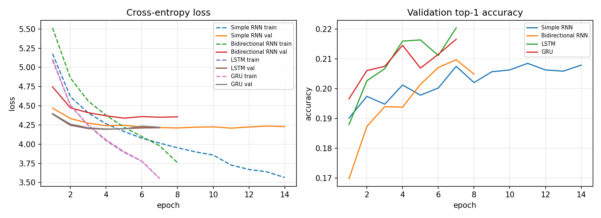
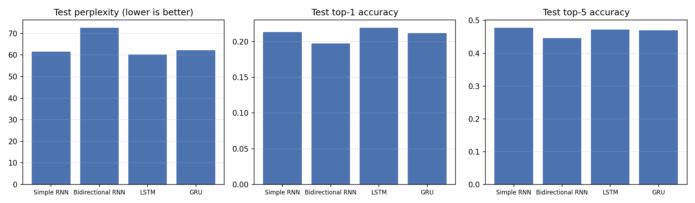
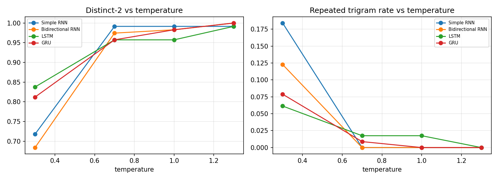

# Next-Word Prediction with Recurrent Networks: RNN vs BiRNN vs LSTM vs GRU

Foundations of Generative AI (ICT4403) - Assignment 2

- **Student:** Unmesh
- **Registration Number:** 230911030
- **Dataset:** *A Study in Scarlet* by Arthur Conan Doyle - [Project Gutenberg #244](https://www.gutenberg.org/ebooks/244)
- **Repository:** https://github.com/unmesh1621-ai/fgai-rnn-text-generation

## Overview

This project trains four word-level recurrent language models to predict the
next word from the previous 10 words, compares them on held-out text, and uses
each model to generate new text at different sampling temperatures.

The models are:

| Model | Recurrent core | Summary vector fed to the classifier |
| --- | --- | --- |
| Simple RNN | `nn.RNN` (tanh) | hidden output at the last time step |
| Bidirectional RNN | `nn.RNN(bidirectional=True)` | mean over time of forward + backward outputs |
| LSTM | `nn.LSTM` | hidden output at the last time step |
| GRU | `nn.GRU` | hidden output at the last time step |

All four share the same surrounding layers, so the recurrent core is the only thing
that changes:

```
10 word ids -> Embedding(256) -> Dropout -> Recurrent core (256 units)
            -> summary vector -> LayerNorm -> Dropout -> Linear(vocab) -> softmax
```

## Dataset and preprocessing

1. The Project Gutenberg licence header and footer are removed.
2. The text is lowercased and split into words and punctuation marks
   (`. , ! ? ; :`) with a regular expression. Words keep internal apostrophes (`don't`).
3. The token stream is split **in order** into 80% train, 10% validation and 10% test.
   A contiguous split means no 10-word window can appear in two splits.
4. The vocabulary is built from the **training split only**, keeping words seen at
   least 3 times. Other words map to `<unk>`.
5. Every 10-word window is paired with the word that follows it (the target).

| Statistic | Value |
| --- | --- |
| Total tokens | 49,681 |
| Train / val / test tokens | 39,744 / 4,968 / 4,969 |
| Vocabulary size (incl. `<pad>`, `<unk>`) | 1,543 |
| Test tokens that are `<unk>` | 12.2% |
| Train / val / test windows | 39,734 / 4,958 / 4,959 |

The 12% unknown rate in the test split is high because the last part of the book
introduces new names and places. This makes the task harder but keeps the
evaluation honest, since nothing from the test text leaks into the vocabulary.

## Training setup

All models use the same settings and the same random seed (1621):

| Setting | Value |
| --- | --- |
| Context length | 10 words |
| Embedding / hidden size | 256 / 256 |
| Dropout | 0.4 |
| Optimiser | AdamW, lr 2e-3, weight decay 1e-4 |
| LR schedule | ReduceLROnPlateau (halve after 1 epoch without improvement) |
| Batch size | 128 |
| Gradient clipping | max norm 0.5 |
| Max epochs / early stopping | 20 / stop after 3 epochs without validation improvement |

The weights from the epoch with the lowest validation loss are kept and evaluated
on the test set.

### Hyperparameter tuning

The settings above were chosen by validation loss only. The test set was not
looked at until the final run. Starting from embedding 128 / dropout 0.3, these
variants were tried on the LSTM and GRU (best validation loss, lower is better):

| Variant | LSTM val loss | GRU val loss |
| --- | ---: | ---: |
| Starting point (emb 128, dropout 0.3, lr 2e-3) | 4.216 | 4.247 |
| Tied input/output embeddings, dropout 0.5 | 4.288 | 4.393 |
| Tied embeddings, dropout 0.5, context 20 | 4.272 | 4.392 |
| Dropout 0.4, lr 1e-3 | 4.199 | 4.210 |
| Dropout 0.4, weight decay 1e-2 | 4.194 | 4.225 |
| **Embedding 256, dropout 0.4 (chosen)** | **4.194** | **4.198** |

Weight tying and heavy dropout hurt: with only ~1,500 words in the vocabulary, the
models are limited by the small amount of training text more than by size, so
too much regularisation cuts into what they can learn. A larger embedding with
moderate dropout gave the best balance.

## Results

### Test set

| Model | Parameters | Best epoch | Test loss | Perplexity | Top-1 acc | Top-5 acc | Train time (s, CPU) |
| --- | ---: | ---: | ---: | ---: | ---: | ---: | ---: |
| Simple RNN | 923,655 | 11 | 4.120 | 61.6 | 21.3% | **47.8%** | 55.8 |
| Bidirectional RNN | 1,450,759 | 5 | 4.285 | 72.6 | 19.7% | 44.6% | 53.8 |
| **LSTM** | 1,318,407 | 4 | **4.099** | **60.3** | **21.9%** | 47.3% | 57.1 |
| GRU | 1,186,823 | 4 | 4.131 | 62.2 | 21.2% | 47.0% | 52.0 |

Compared with the starting configuration, test perplexity improved for every
model: LSTM 63.1 → 60.3, GRU 65.4 → 62.2, Simple RNN 67.5 → 61.6, BiRNN 72.7 → 72.6.




**Observations**

- LSTM is the best model, with the lowest perplexity (60.3) and the highest top-1
  accuracy (21.9%). Its gates and separate cell state keep useful information across
  the 10-word window.
- The Simple RNN gained the most from tuning and came close to the gated models. It
  also trained for longest (best epoch 11). On a short 10-word window the vanishing
  gradient problem is mild, so the gates matter less than they would on long sequences.
- GRU sits between the two, with about 10% fewer parameters than the LSTM.
- The Bidirectional RNN has the most parameters but the worst scores. Reading the
  window backwards adds little for next-word prediction, because the most useful
  signal is the last few words. The extra capacity mostly leads to overfitting.
- All models overfit quickly on a 40k-word corpus. Training loss keeps falling
  while validation loss bottoms out after 3-6 epochs, which is why early stopping
  matters here.

### Temperature analysis

Each model continues three prompts (`"it was the"`, `"sherlock holmes said that"`,
`"the man who had"`) for 40 new words at temperatures 0.3, 0.7, 1.0 and 1.3.
Only the newly generated words are scored:

- **Distinct-1 / Distinct-2:** unique unigrams / bigrams divided by the total (higher means more varied).
- **Repeated trigrams:** share of trigrams that already appeared earlier in the same output (higher means more looping).
- **Rare-word share:** share of generated words that appear fewer than 10 times in training.

| Model | T | Distinct-1 | Distinct-2 | Repeated trigrams | Rare-word share |
| --- | ---: | ---: | ---: | ---: | ---: |
| Simple RNN | 0.3 | 0.533 | 0.718 | 0.184 | 0.108 |
| Simple RNN | 0.7 | 0.783 | 0.992 | 0.000 | 0.167 |
| Simple RNN | 1.0 | 0.783 | 0.992 | 0.000 | 0.117 |
| Simple RNN | 1.3 | 0.858 | 0.992 | 0.000 | 0.208 |
| Bidirectional RNN | 0.3 | 0.442 | 0.684 | 0.123 | 0.108 |
| Bidirectional RNN | 0.7 | 0.683 | 0.974 | 0.000 | 0.108 |
| Bidirectional RNN | 1.0 | 0.767 | 0.983 | 0.000 | 0.183 |
| Bidirectional RNN | 1.3 | 0.875 | 1.000 | 0.000 | 0.200 |
| LSTM | 0.3 | 0.600 | 0.838 | 0.061 | 0.075 |
| LSTM | 0.7 | 0.733 | 0.957 | 0.018 | 0.108 |
| LSTM | 1.0 | 0.750 | 0.957 | 0.018 | 0.142 |
| LSTM | 1.3 | 0.842 | 0.992 | 0.000 | 0.217 |
| GRU | 0.3 | 0.608 | 0.812 | 0.079 | 0.092 |
| GRU | 0.7 | 0.725 | 0.957 | 0.009 | 0.092 |
| GRU | 1.0 | 0.800 | 0.983 | 0.000 | 0.133 |
| GRU | 1.3 | 0.858 | 1.000 | 0.000 | 0.242 |



Sample outputs (LSTM):

> **T = 0.3** - *the man who had* been a long of the same. i have no doubt that i had no idea that the man was a man of the door. he was a cab, and the two castaways and the door, and

> **T = 0.7** - *the man who had* been it? i asked. no answer, he said, and the other up, but, he said. the two detectives and a little girl in the morning, and the line of their fire,

> **T = 1.3** - *the man who had* been warm and gardens before they made our prophet. here would make above from escape half you don't i know my him.

**Observations**

- **Low temperature (0.3)** sharpens the distribution towards the most likely words.
  Output is grammatical in short stretches but falls into loops ("the two castaways,
  and the two detectives, and the two castaways"). Repeated trigrams reach 18% for
  the Simple RNN and 12% for the BiRNN at T = 0.3.
- **Medium temperature (0.7)** gives the best balance. Loops almost disappear, and
  the text still reads like the book (dialogue, "i asked", "sherlock holmes").
- **High temperature (1.0-1.3)** flattens the distribution. Diversity hits its
  maximum (Distinct-2 near 1.0) and rare words like "prophet" and "hospital"
  show up, but grammar breaks down.
- Diversity metrics alone reward the incoherent high-temperature text. They have
  to be read alongside perplexity and the actual samples.

All generated samples are in [`results/samples.txt`](results/samples.txt).

## Why the Bidirectional RNN can still generate text

A bidirectional network normally sees words on both sides of a position, which
would break left-to-right generation. Here the BiRNN only ever reads the
10-word context window. Its backward pass runs over those same 10 past words, never
over future ones, and the model predicts the word *after* the window. Generation
therefore stays autoregressive: each sampled word is appended and the window slides
forward by one.

## Project structure

```
fgai-rnn-text-generation/
├── main.py                 # full pipeline: data -> train 4 models -> evaluate -> sample -> plots
├── textgen/
│   ├── data.py             # Gutenberg cleanup, tokeniser, vocabulary, windowed datasets
│   ├── models.py           # NextWordModel (rnn / birnn / lstm / gru)
│   ├── training.py         # training loop with early stopping, evaluation metrics
│   └── sampling.py         # temperature sampling, diversity metrics
├── data/a_study_in_scarlet.txt
├── results/                # metrics CSVs, plots, samples, best checkpoints (*.pt)
├── train_log.txt           # console log of the run that produced results/
└── requirements.txt
```

## How to run

```bash
pip install -r requirements.txt
python main.py            # final configuration, about 4 minutes on a laptop CPU
python main.py --quick    # 2-epoch smoke test
```

Useful options: `--context`, `--epochs`, `--batch`, `--gen-words`, `--seed`, `--out`.
